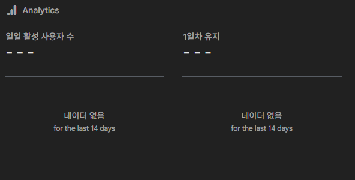
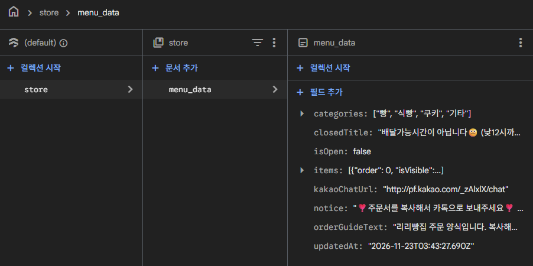
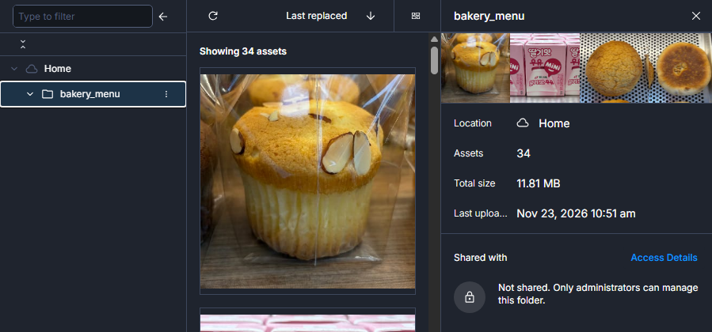
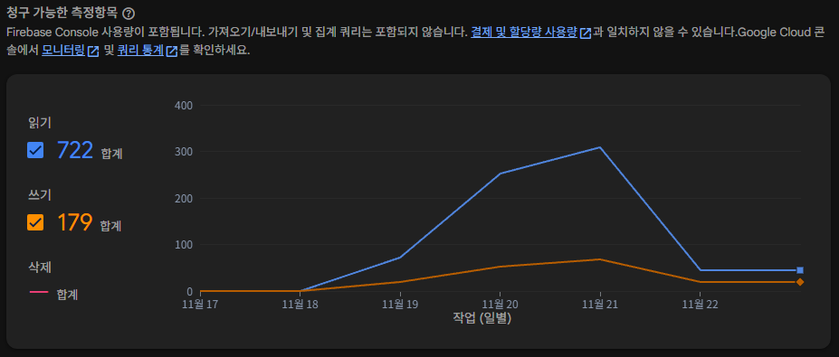
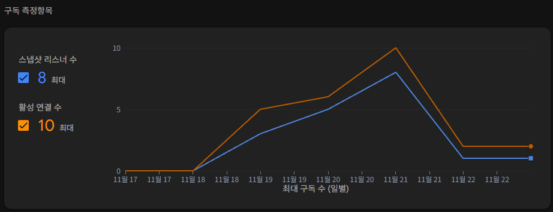
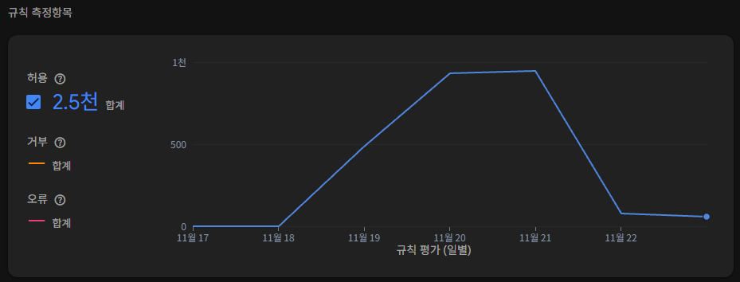
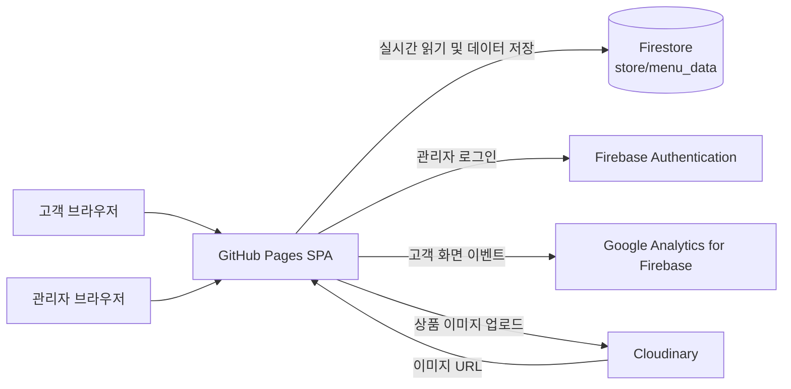

# 리리빵집 재고알리미
빵집의 당일 상품과 재고를 손님에게 실시간으로 안내하는 모바일 웹 애플리케이션입니다.

## 운영 요약
| 날짜 | 이력 |
| --- | --- |
| 2026-11-18 | 개발 착수, 데이터베이스 세팅 및 배포 환경 구성 |
| 2026-11-20 | 서비스 핵심 로직 완성, 실제 고객 사용자에게 배포 및 서비스 시작 |
| 2026-11-23 | 관리자 편집기능 추가, 분석 도구 연동 |

## 서비스 접속 방법
| QR 코드 | 상세 |
| :---: | :---: |
|| 카메라로 해당 QR 코드를 스캔하면 현재 운영중인 실제 서비스에 접속할 수 있습니다. |

### 실제 서비스 주소
| 주소 | 상세 |
| :--- | :--- |
| liribbangzip.kro.kr/# | 손님이 조회하는 페이지입니다. 해당 페이지를 중심으로 트래픽을 집계합니다. |
| liribbangzip.kro.kr/#/admin | 관리자 전용 페이지입니다. Firebase에 등록된 계정에 한해 로그인해서 실제 매장 데이터를 편집할 수 있습니다. |

### 로컬 페이지의 경우
| 주소 | 상세 |
| :--- | :--- |
| localhost:5173/# | 손님이 조회하는 페이지입니다. |
| localhost:5173/#/admin | 관리자 전용 페이지입니다. |

## 시연 화면
- 고객 화면 캡처: [이미지 경로 또는 링크 작성 필요]
- 관리자 화면 캡처: [이미지 경로 또는 링크 작성 필요]

## 주요 기능
### 고객 기능
| 기능 | 설명 |
| --- | --- |
| 상품 조회 및 검색 | 고객이 판매 중인 상품과 재고 현황을 확인하고 카테고리 및 상품명으로 검색할 수 있습니다. |
| 영업·품절 안내 | 상품의 품절 상태와 매장 영업 여부를 확인할 수 있습니다. |
| 실시간 데이터 동기화 | Firestore 변경 사항이 고객 화면에 실시간으로 반영됩니다. 브라우저 탭이 숨겨지면 실시간 구독을 중지합니다. |
| 트래픽 이벤트 측정 | GA4로 고객 메뉴 페이지뷰, 카카오 주문 안내 열기, 카카오톡 채팅방 열기 이벤트를 기록합니다. |

### 관리자 기능
| 기능 | 설명 |
| --- | --- |
| 상품 및 재고 관리 | 관리자는 로그인 후 상품 등록·수정·삭제와 재고·품절·노출 상태를 관리할 수 있습니다. |
| 진열 순서 편집 | 관리자 화면에서 상품 진열 순서와 카테고리 탭 순서를 편집할 수 있습니다. |
| 매장 안내 설정 | 공지, 휴무 안내, 주문 안내 문구와 카카오톡 문의 링크를 설정할 수 있습니다. |
| 상품 이미지 처리 | 상품 이미지를 자르고 WebP로 변환해 업로드할 수 있습니다. |

## 트래픽 분석
| 이미지 | 상세 |
| --- | --- |
|  | 2026-11-23 기준 GA 연동을 시작해 트래픽을 수집하고 있습니다. 현 시점 기준 누적 집계된 데이터가 부족합니다. |

## 데이터베이스 운영 기록

### 실제 운영 데이터 조회
| 이미지 | 상세 |
| --- | --- |
|  | Firebase 데이터베이스에 JSON 형식과 동일한 Key-Value 형식으로 서비스 데이터가 저장됨 |
|  | Cloudinary 데이터베이스에 실제 이미지 파일이 저장됨 |

### 읽기 및 쓰기

| 측정일 | 상세 |
| --- | --- |
| 2026-11-23 | 서비스 배포 후 실제 손님의 누적 접속량이 간접적으로 확인되었습니다. 배포 직후 500번 이상의 읽기 이벤트가 발생, 단순계산 기준 1번의 쓰기 작업마다 5번의 읽기 이벤트가 발생한 것을 확인할 수 있었습니다. 매장이 영업하지 않는 일요일(22일) 기준 지표가 감소하는 추세를 확인할 수 있습니다. 손님 페이지에서는 쓰기 이벤트가 발생하지 않습니다. |

### 구독 측정

| 측정일 | 상세 |
| --- | --- |
| 2026-11-23 | 서비스 배포 후 실제 손님의 동시 접속량이 간접적으로 확인되었습니다. 브라우저 혹은 브라우저의 탭이 디바이스에서 보여지고 있지 않은 유휴상태의 경우 이벤트 리스너가 정지하며 집계되지 않습니다. 매장이 영업하지 않는 일요일(22일) 기준 지표가 감소하는 추세를 확인할 수 있습니다. |

### 규칙 측정

| 측정일 | 상세 |
| --- | --- |
| 2026-11-23 | 개발 시점 이후부터 서비스 자체의 읽기/쓰기 로직이 서버에 정상적으로 반영되는 것이 확인됩니다. 권한 등 요소에 따른 거부 로직은 존재하지 않으며, 오류 또한 검출되지 않아 서비스가 정상적으로 작동하고 있음을 확인할 수 있습니다. |

## 기술 스택
| 구분 | 기술 |
| --- | --- |
| 프론트엔드 | React 19, TypeScript, Vite |
| 스타일링 | Tailwind CSS v4 |
| 라우팅 | React Router의 HashRouter |
| 데이터베이스 및 인증 | Firebase Firestore, Firebase Authentication |
| 트래픽 분석 | Google Analytics for Firebase (GA4) |
| 이미지 처리 및 호스팅 | HTML Canvas, Cloudinary unsigned upload |
| 배포 | GitHub Pages, GitHub Actions |

## 서비스 아키텍처
고객과 관리자는 GitHub Pages에 배포된 SPA에 접속합니다. 앱은 Firebase Authentication으로 관리자 로그인 상태를 확인하고, Firestore의 단일 `store/menu_data` 문서에서 상품과 매장 데이터를 읽고 씁니다. 상품 이미지는 브라우저에서 가로 최대 400px, WebP 품질 0.75로 변환한 뒤 Cloudinary에 업로드하고, 반환된 이미지 URL을 Firestore 데이터에 저장합니다.

## 최적화
| 전략 | 로직 및 원리 | 적용 이유와 효과 |
| --- | --- | --- |
| 상품 이미지 사전 압축 | 관리자가 이미지를 선택하면 브라우저 Canvas에서 가로 최대 400px, WebP 품질 0.75로 변환한 뒤 Cloudinary에 업로드합니다. | 원본 사진보다 업로드 데이터 크기를 줄여 모바일 네트워크의 전송 부담과 업로드 대기 시간을 낮춥니다. 이미지 바이너리를 Firestore 문서에 넣지 않고 URL만 저장합니다. |
| 매장 데이터를 단일 문서로 관리 | 상품별 문서를 따로 만들지 않고 상품 목록과 매장 설정을 Firestore `store/menu_data` 한 문서에 함께 저장합니다. 배포 산출물에는 상품 데이터를 넣지 않으며, 앱이 실행될 때 이 문서를 읽습니다. | 상품마다 별도 문서를 조회하거나 실시간 구독을 붙이지 않아도 되어 읽기 및 리스너 관리가 단순해집니다. 대신 한 문서에 데이터가 모이므로 문서 크기와 동시 수정이 커지는 경우에는 현재 구조가 적합한지 다시 검토해야 합니다. |
| 클라이언트에서 목록 필터링 | 한 번 읽은 상품 목록에서 카테고리·검색어 필터링과 정렬을 브라우저에서 수행합니다. | 검색이나 탭 변경 때마다 데이터베이스를 다시 조회하지 않아 불필요한 읽기를 줄이고 화면 반응을 빠르게 합니다. |
| 숨겨진 탭의 실시간 구독 중지 | `document.hidden` 상태가 되면 Firestore `onSnapshot` 구독을 해제하고, 탭이 다시 보이면 구독을 재개합니다. | 보고 있지 않은 탭에서 실시간 연결을 계속 유지하지 않아 불필요한 업데이트 수신과 읽기 이벤트를 줄입니다. 다시 표시될 때 최신 데이터를 재수신합니다. |
| 화면 단위 지연 로딩 | 고객 화면과 관리자 화면을 `React.lazy`로 분리하고 현재 경로의 화면만 불러옵니다. | 처음 접속할 때 반대 화면의 코드까지 함께 받지 않아 초기 JavaScript 다운로드와 파싱 부담을 줄입니다. |
| 이미지 업로드 코드 지연 로딩 | 이미지 업로드 모듈을 저장 시점에 동적 import합니다. | 상품 이미지 작업이 없는 고객 화면이나 일반 관리 흐름에서 업로드 코드를 초기 번들로 불러오지 않습니다. |
| 관리자 변경사항 묶음 저장 | 관리 화면의 초안 모드에서는 여러 편집을 브라우저 상태에 모아두고 저장 시 한 번에 Firestore에 반영합니다. | 재고·상품·안내를 편집할 때 발생하는 잦은 개별 쓰기를 줄입니다. 즉시 반영 작업은 Firestore 트랜잭션으로 처리해 최신 서버 데이터 기준으로 변경합니다. |
| 운영 환경에서만 분석 초기화 | GA4 측정 ID와 지원 환경이 있을 때만 Analytics를 초기화하고, 개발 모드에서는 수집하지 않습니다. 페이지뷰는 직접 기록하며 자동 페이지뷰를 끕니다. | 개발 및 관리자 이용이 고객 트래픽에 섞이는 것을 줄이고, HashRouter 경로 변경으로 인한 중복 페이지뷰를 방지합니다. |
