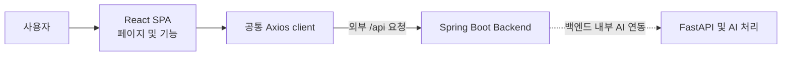
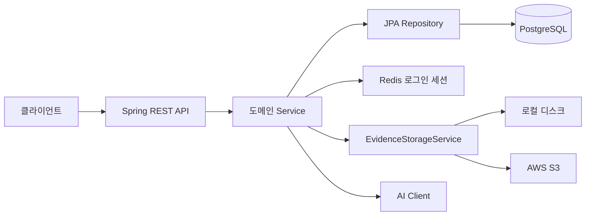
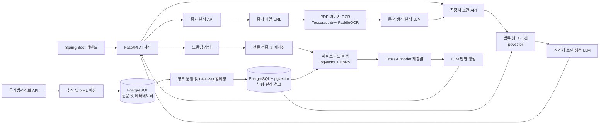

## 프로젝트 개요

법률·행정 지원 서비스 WorkHelper 입니다.
노동법 상담, 증거 문서 분석, 임금체불 진정서 초안 작성과 법률 데이터 기반 검색을 제공합니다.
사용자는 일반 사용자와 전문자격 노무사, 시스템 관리자로 구분됩니다.

## 프로젝트 보고서
| 보고서 | 별첨 |
| :---: | :---: |
|  |  |

## 팀 구성 및 역할 분담

| 담당자 | 구분 | 역할 |
| --- | --- | --- |
| 박성진(PM) | AI 서버 | 내부 API, OCR, LLM 워크플로우 및 RAG 개발, AI 서버 CI/CD, AI 서버 버전 관리 |
| 권순현(PL) | AI 서버 | 법령·판례 수집, 파싱, 임베딩 및 DB 적재, RAG, AI 채팅상담 개발, 백엔드 CI/CD |
| 이규원(AA) | 프론트/백 | DB 설계 및 구축, 외부 API 연동, 내부 AI API 연동, 프론트엔드/백엔드 버전 관리 |
| 홍동연 | 프론트/백 | AI 채팅상담 화면구현, 사건목록 화면구현, 화면 UI 구현 |
| 홍은지 | 프론트/백 | 로그인 및 회원가입 화면구현, JWT + Redis Session 기반 인증 세션 구현, React Router 기반 라우팅 제어 |
| 홍은영 | 프론트/백 | 전문가 QnA 화면구현, JWT 기반 사용자 권한별 분기 처리, S3 파일 업로드 로직 구현, 통합 테스트 |

## 서비스 화면

| 메인화면 | 로그인 화면 | 사건 관리 화면 |
| :---: | :---: | :---: |
|  |  |  |

| AI 채팅 상담 화면 | 증거 서류 분석 화면 | 진정서 작성 초안 화면 |
| :---: | :---: | :---: |
|  |  |  |

## 주요 기능

- JWT 인증 및 Redis 기반 로그인 세션 관리를 통해 회원가입과 로그인 기능을 제공합니다.
- 이미지 및 PDF 증거 파일을 URL로 받아 OCR 처리하고, 추출 텍스트와 법적 쟁점 분석 결과를 반환합니다.
- 대화 내용과 선택적 증거 분석 결과를 바탕으로 임금체불 진정서 초안을 작성합니다.
- 노동법 상담 질문을 검증·재작성한 뒤 법령 및 판례 검색 결과에 기반해 답변합니다.
- 국가법령정보 공동활용 API에서 법령·판례를 수집하고 파싱하여 PostgreSQL에 저장합니다.
- 법령·판례 원문을 청크로 나누고 BGE-M3 임베딩을 생성해 pgvector 검색에 사용합니다.
- 벡터 검색과 BM25 키워드 검색 결과를 결합하고 Cross-Encoder로 재정렬합니다.

## 기술 스택

| 구분 | 기술 |
| --- | --- |
| 언어 및 API 서버 | Python 3.12, FastAPI, Uvicorn, Pydantic |
| LLM 및 체인 | LangChain, OpenAI API, Ollama |
| 데이터베이스 및 검색 | PostgreSQL, pgvector, psycopg, BM25, FlagEmbedding |
| 임베딩 및 재정렬 | `BAAI/bge-m3`, `BAAI/bge-reranker-v2-m3`, Sentence Transformers |
| OCR 및 문서 처리 | Tesseract, PaddleOCR, Pillow, PyMuPDF |
| 데이터 수집 | 국가법령정보 공동활용 API, Requests, lxml, Beautiful Soup |
| 실행 환경 | Docker, python-dotenv |

## 사용 외부 API

| API | 용도 | 인증 환경 변수 |
| --- | --- | --- |
| 국가법령정보 공동활용 Open API | 법령 및 판례 데이터 수집 | `LAW_OPENAPI_OC` |
| OpenAI API | 노동법 상담 및 선택형 문서 분석·초안 생성 | `OPENAI_API_KEY` |
| Ollama | 로컬 LLM을 사용하는 문서 분석·초안 생성 | `OLLAMA_BASE_URL` (인증 키 없음) |
| 증거 파일 제공 URL | 이미지·PDF 다운로드 및 OCR | 요청의 `fileUrl`에 포함된 접근 정보; 저장소 제공자와 인증 방식은 [내용 입력 필요] |

## 서비스 아키텍처

### 프론트엔드

### 백엔드

### AI 서버

## 향후 개선 계획

- 서버 인프라 확충: sLLM 적재 및 기타 로직 응답속도 개선을 위한 서버 사양 증설 및 GPU 추가
- 보안 강화: sLLM을 통한 개인정보 처리로 보안 강화
- 서비스 품질 개선: 프롬프트 엔지니어링, OCR 모델 교체를 통한 기능 및 서비스 품질 향상
